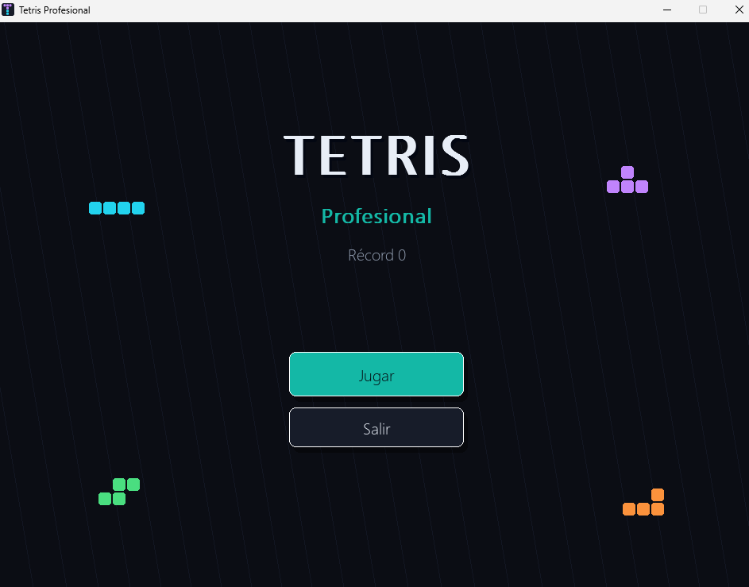
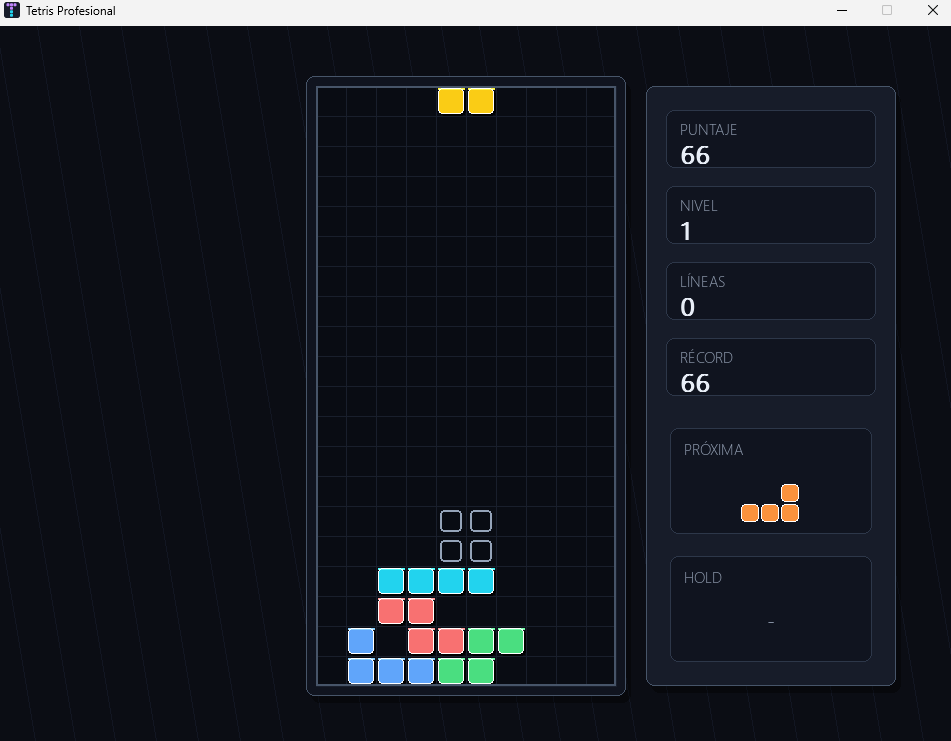

# Tetris en Python con Pygame

Recreación del clásico juego **Tetris** desarrollada en **Python 3** con **Pygame (`pygame-ce`)**, estructurada con programación orientada a objetos.

Incluye menú principal, pausa, pantalla de fin de partida, sistema de niveles y puntaje, pieza fantasma (*ghost piece*), reserva de pieza (*hold*), vista previa de la siguiente pieza, efectos de sonido generados por código (reemplazables por archivos propios) y persistencia del récord en un archivo JSON.

## Capturas




## Características reales del código

- **7 tetrominós oficiales** (`I`, `O`, `T`, `S`, `Z`, `J`, `L`) definidos en `src/piece.py` mediante `@dataclass`.
- **Rotación estilo SRS (*Super Rotation System*):** Tablas de compensación (*wall kicks*) para piezas `JLSTZ` e `I`.
- **Mecánicas completas (`src/board.py` y `src/game.py`):** Detección de colisiones, proyección de caída (*ghost piece*), *soft drop*, *hard drop*, *hold* de pieza y velocidad progresiva por nivel.
- **Audio con respaldo automático (`AudioManager`):** Si las carpetas de `assets/` no contienen archivos `.wav` u `.ogg`, el juego sintetiza efectos de sonido y música mediante ondas senoidales (`math.sin` y `array`).
- **Persistencia (`src/score.py`):** Lectura y guardado automático del puntaje máximo en `high_score.json`.

## Tecnologías utilizadas

- **Python 3** (`dataclasses`, `enum`, `json`, `math`, `array`, `random`, `pathlib`)
- **Pygame (`pygame-ce >= 2.5.7`)**

## Estructura del proyecto

```text
Tetris/
├── assets/
│   ├── fonts/
│   ├── images/
│   ├── music/
│   └── sounds/
├── docs/
│   └── screenshots/
├── src/
│   ├── board.py      # Tablero 10x20, colisiones, ghost piece y limpieza de líneas
│   ├── config.py     # Constantes de ventana, colores, tiempos y rutas
│   ├── game.py       # Bucle principal, estados del juego y AudioManager
│   ├── piece.py      # Tetrominós, rotaciones y wall kicks SRS
│   ├── score.py      # Cálculo de puntaje, niveles y persistencia en JSON
│   └── ui.py         # Renderizado del tablero, paneles laterales y menús
├── main.py           # Punto de entrada
├── requirements.txt
└── LICENSE
```

## Instalación y ejecución

1. Clonar el repositorio y entrar a la carpeta del proyecto:

```bash
git clone https://github.com/Uri46/Tetris.git
cd Tetris
```

2. Crear y activar un entorno virtual:

```bash
python -m venv .venv
# En Windows:
.venv\Scripts\activate
# En Linux / macOS:
source .venv/bin/activate
```

3. Instalar la dependencia y ejecutar el juego:

```bash
pip install -r requirements.txt
python main.py
```

## Controles

| Acción | Tecla |
| :--- | :--- |
| Mover izquierda / derecha | Flechas `←` / `→` |
| Caída suave (*Soft Drop*) | Flecha `↓` |
| Rotar pieza | Flecha `↑` |
| Caída instantánea (*Hard Drop*) | `Espacio` |
| Guardar pieza (*Hold*) | `Shift` |
| Pausar partida | `P` |
| Mostrar / ocultar FPS | `F` |
| Salir / Volver | `Esc` |

## Licencia

Publicado bajo licencia MIT (ver archivo `LICENSE`).
